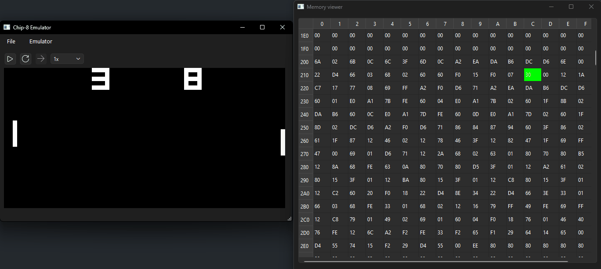

<div align="center">


A CHIP-8 emulator written in **C++17** using **Qt6 Widgets**.

Featuring emulation, save states, an integrated live memory viewer, emulator controls, and debugging tools.


<p>      </p>

**This project has reached end of development.**

</div>

## Demo

<p align="center">
  Pong running while the live memory viewer updates in real time.
  
  
</p>

<p align="center">
  <sup>GIF compression introduces ghosting artifacts that are not present in the emulator.</sup>
</p>

---

## Features

- CHIP-8 emulation
- Qt6 Widgets desktop interface
- Live memory viewer
- Live memory editing
- Save/Load game state
- Program Counter (PC) and Index Register (I) highlighting in memory viewer
- Play, Pause, Step, and Reset controls
- Adjustable execution speed (0.125×–4×)
- Sound emulation
- Recent ROMs menu
- Persistent compatibility presets for instruction differences
- Safe execution stops with diagnostics for invalid memory and stack operations

## Building

***Requirements***
- C++17 compiler
- Qt 6.7+ (Core, Widgets, and Multimedia)
- CMake 3.19+

```bash
git clone https://github.com/TopiLep/QtChip8.git
cd QtChip8

cmake -B build
cmake --build build
```
> [!TIP]
> Building the project with **Qt Creator** is recommended, since it automatically detects your Qt installation and configures CMake for you.

## Tests

The emulator core and loading regression tests can be built without Qt:

```bash
cmake -S . -B build-tests -DBUILD_GUI=OFF -DCMAKE_BUILD_TYPE=Debug
cmake --build build-tests
ctest --test-dir build-tests --output-on-failure
```

Tests cover save-state round trips, truncated and invalid save files, ROM size
limits, and preserving the current game when a load fails. GitHub Actions runs
these tests with AddressSanitizer and UndefinedBehaviorSanitizer. Execution tests
cover compatibility presets, arithmetic flag/register aliases, sprite collisions,
and memory/stack boundaries. A normal Qt build also includes an offscreen
preferences integration test (preset selection, persistence, and reset).

Save states keep the existing binary format (native byte order). Loading rejects
incomplete files, trailing data, invalid execution addresses or stack depth,
and invalid pixels. Successful loads refresh the display and release held keys.
ROM files must contain 1–3584 bytes; failed loads leave the current game intact.

## Compatibility and execution

Open **Preferences → Emulation** to select an instruction preset. The selection
is saved between launches and applies immediately. Reload the ROM after changing
modes for a fresh start. Existing behavior remains the default.

| Behavior | QtChip8 (default) | Original CHIP-8 | CHIP-48 |
| --- | --- | --- | --- |
| Shift source | Vx | Vy | Vx |
| Increment I after Fx55/Fx65 | No | Yes | No |
| Bnnn jump offset | V0 | V0 | Vx |
| Sprite overflow at screen edges | Wrap | Clip | Clip |
| Clear VF after OR/AND/XOR | No | Yes | No |

These are instruction presets, not complete implementations of the historical
machines. The instruction differences follow the
[CHIP-8 implementation guide](https://tobiasvl.github.io/blog/write-a-chip-8-emulator/).
Legacy save files do not store the preset: select the same mode before restoring.

Out-of-range memory operations and stack underflow/overflow halt execution,
silence sound, and display the failing address and reason in the status bar.
Reset or load another ROM/save to recover. Unrecognized instructions continue
to be ignored. Keyboard auto-repeat is ignored, held keys are released when
focus changes, and the configured Pause binding toggles playback.

## Known limitations
- Compatibility presets cover instruction differences; cycle-accurate COSMAC VIP timing, display-wait and key-release quirks are not emulated.
- SUPER-CHIP / XO-CHIP extended opcodes are not supported.

## Roadmap

- [x] Memory editing
- [x] Mappable controls
- [x] Compatibility presets
- [x] Save/load state
